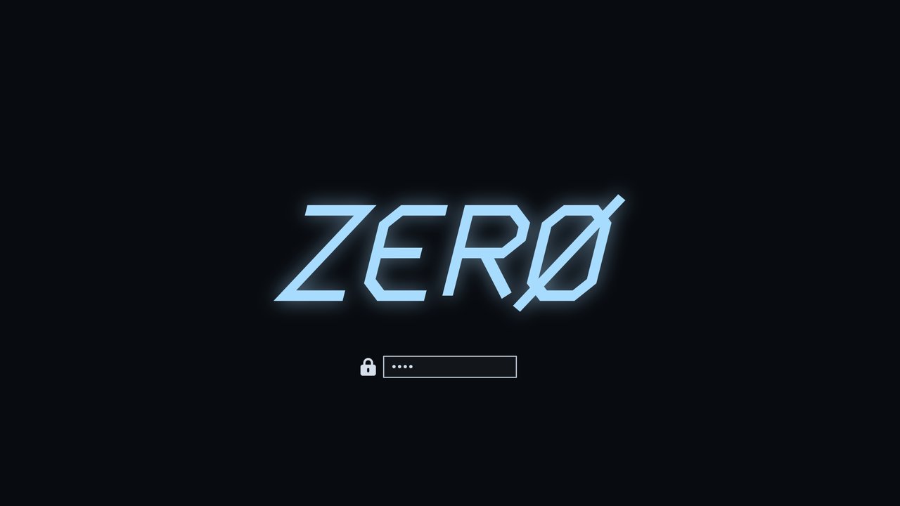

# ❄ FrostLayer

Capa de estética **Frost** para [Omarchy](https://omarchy.org): azul hielo sobre negro, esquinas suaves, desenfoque y un arranque limpio. No sustituye a Omarchy. Se instala encima, por módulos, y se puede deshacer entera.


## Instalar

En un Omarchy ya instalado:

```bash
curl -fsSL https://raw.githubusercontent.com/raulplz/FrostLayer/main/install.sh | bash
```

Se abre un menú para elegir módulos (vienen marcados los de por defecto). Para instalar sin preguntas los módulos por defecto:

```bash
curl -fsSL https://raw.githubusercontent.com/raulplz/FrostLayer/main/install.sh | bash -s -- --yes
```

El instalador clona el repositorio en `~/.local/share/frostlayer` y deja el comando `frostlayer` en `~/.local/bin`. No se ejecuta como root. Solo el módulo `boot` pide contraseña, a través de la herramienta oficial de Omarchy.

¿Prefieres leer antes de ejecutar? Es buena idea:

```bash
git clone https://github.com/raulplz/FrostLayer.git ~/.local/share/frostlayer
~/.local/share/frostlayer/bin/frostlayer install --dry-run
```

## Módulos

| Módulo | Por defecto | Qué hace |
|---|---|---|
| `theme` | sí | Tema de Omarchy `frost`: paleta, fondo propio e iconos de carpeta Frost (sobre Yaru-blue). |
| `hyprland` | sí | Esquinas de 14 px, márgenes, desenfoque, atenuado leve de ventanas inactivas y animación de escritorios en deslizamiento. |
| `gtk` | sí | Colores Frost en aplicaciones GTK3/GTK4 (Nautilus, ajustes…). |
| `boot` | no | Pantalla de arranque y desbloqueo con el logo ZERØ. Pide sudo y regenera la imagen de arranque. |
| `brave` | no | Brave más limpio: pestañas verticales plegadas, nueva pestaña Frost con solo el reloj, sin botones de Leo/Wallet/Rewards/News y ahorro de memoria. Brave debe estar cerrado. |



## Uso

```bash
frostlayer install [módulo…]     # sin nombres: menú
frostlayer uninstall [módulo…]   # sin nombres: todo lo instalado
frostlayer status                # qué está aplicado
frostlayer list                  # módulos disponibles
frostlayer update                # baja la última versión y reaplica lo instalado
```

Opciones: `--yes` (sin preguntas) y `--dry-run` (muestra lo que haría sin tocar nada).

Ejemplos: `frostlayer install boot`, `FROSTLAYER_LOGO=~/mi-logo.png frostlayer install boot`.

## Cómo cuida tu sistema

- **Copias antes de tocar.** Cada archivo modificado se guarda en `~/.local/state/frostlayer/backups/`.
- **Bloques marcados.** En `hyprland.lua` y `gtk.css` solo añade un bloque entre `>>> FrostLayer` y `<<< FrostLayer`. Tu configuración no se reescribe y reinstalar no duplica nada.
- **Deshacer de verdad.** `frostlayer uninstall` devuelve los archivos a su estado anterior, vuelve a tu tema previo de Omarchy y quita solo lo que FrostLayer creó.
- **Hyprland con red.** Si la configuración Frost diera error al recargar, se retira sola.
- Tras un `omarchy update`, Omarchy puede restaurar su pantalla de arranque. Basta con `frostlayer install boot`.

## Qué no incluye (todavía)

- **Barra y lanzador alternativos.** Quedan para una versión futura como módulo opcional, con su licencia respetada.
- **Configuración personal**: monitores, paquetes, atajos propios o datos de navegador. FrostLayer es solo estética y no copia nada de nadie.
- **Tema de color de Brave.** Brave lo protege y lo restaura al arrancar. Se elige a mano en *Ajustes → Apariencia → Personalizar* con `#4DA3FF`.

## Requisitos

Omarchy reciente (configuración de Hyprland en Lua), `git` y `gum` (ya vienen con Omarchy). `python3` para el módulo `brave`. Probado en Omarchy 4.0.

Para probarlo fuera de Omarchy, bajo tu responsabilidad: `FROSTLAYER_FORCE=1`.

## Estructura

```
install.sh            instalador de una línea
bin/frostlayer        CLI
lib/common.sh         copias, bloques marcados, estado, --dry-run
modules/<nombre>/     module.sh (check · apply · revert) y sus archivos
```

Añadir un módulo es crear `modules/<nombre>/module.sh` con `MODULE_DESC`, `MODULE_DEFAULT` y las funciones `module_check`, `module_apply` y `module_revert`.

---

## English

FrostLayer is a modular **Frost** look for [Omarchy](https://omarchy.org): an Omarchy theme with custom wallpaper and folder icons, Hyprland polish, GTK colours, an optional ZERØ boot screen and an optional cleaner Brave. Every change is backed up, wrapped in marked blocks and fully reversible.

```bash
curl -fsSL https://raw.githubusercontent.com/raulplz/FrostLayer/main/install.sh | bash
frostlayer status
frostlayer uninstall
```

Use `--dry-run` to preview and `--yes` for non-interactive installs. The UI is in Spanish.

## Licencia

[MIT](LICENSE). Fondo, iconos de carpeta y logo ZERØ son originales de este proyecto y se distribuyen con la misma licencia. Los iconos base vienen de Yaru y Breeze, que se instalan como paquetes de tu distribución.
